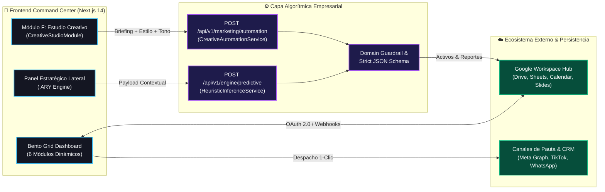
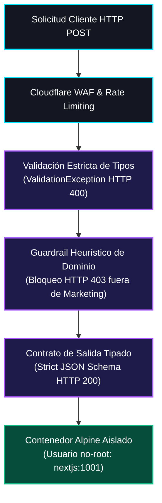

# ⚡ MarketingFlow — Enterprise Marketing Command Center

**Centro de Comando Estratégico, Orquestación Multicanal y Automatización Algorítmica de Pauta Digital conectado en tiempo real con Google Workspace.**

---

## 🎯 1. Problema de Negocio y Solución de Ingeniería

Las direcciones de mercadotecnia y líderes de marca gestionan simultáneamente presupuestos publicitarios (Meta Ads, Google Ads, TikTok Ads), calendarios editoriales, activos en la nube y embudos de prospectos en herramientas fragmentadas, perdiendo trazabilidad financiera y velocidad de ejecución.

**MarketingFlow** unifica toda la operación en una arquitectura **Bento Grid de alto contraste** (`#0A0A0F` / `#141622`) sincronizada con **Google Workspace** (Drive, Sheets, Calendar, Slides y Gmail) e impulsada por dos pipelines algorítmicos empresariales:
- **`HeuristicInferenceService` (`/api/v1/engine/predictive`):** Auditoría de métricas financieras (ROI, CPA, CPL, CTR), redistribución de pujas y estructuración de campañas bajo esquemas JSON estrictos.
- **`CreativeAutomationService` (`/api/v1/marketing/automation`):** Pipeline heurístico con *Domain Guardrail* para la estructuración de piezas visuales publicitarias, redacción persuasiva (AIDA/PAS) y segmentación de audiencias.

---

## 🏗️ 2. Arquitectura del Sistema y Flujo de Datos

---

## 🧩 3. Módulos Operativos del Bento Grid

| Código | Módulo | Capacidades Técnicas | Integración Principal |
| :---: | :--- | :--- | :--- |
| **A** | **Gestión de Proyectos y Campañas** | Control de entregables (SEO, Social Ads, Contenido, Email), barras de progreso y ejecución presupuestaria. | Google Tasks & Sheets |
| **B** | **Métricas y Finanzas en Vivo** | Visualización interactiva con Recharts de ROI (`3.8x`), CPL, CPA, CTR y curvas de inversión diaria. | Google Sheets Live API |
| **C** | **Calendario de Contenidos** | Programación mensual/semanal, edición en línea, vista previa de activos y aprobación en 1 clic. | Google Calendar + Meta Graph |
| **D** | **CRM Omnicanal & WhatsApp** | Captura de leads con *Lead Scoring* (`0-100`), embudo de conversión y automatización de respuesta. | WhatsApp Cloud API + Gmail |
| **E** | **Google Workspace Hub** | Árbol estandarizado de carpetas (`01_Estrategia` a `05_CRM_Leads`) y acceso directo a Docs, Sheets y Slides. | Google Drive + Apps Script |
| **F** | **Estudio Creativo & ` ARY`** | Automatización de propuestas visuales (`1:1`, `9:16`, `16:9`), copywriting AIDA y segmentación táctica. | `/api/v1/marketing/automation` |

---

## 🛡️ 4. Ingeniería de Ciberseguridad (DevSecOps)

- **Aislamiento de Contenedores (Non-Root):** Ejecución sobre `node:20-alpine` en compilación *multi-stage standalone* bajo el usuario sin privilegios `nextjs` (`UID 1001:1001`), con directivas `no-new-privileges:true` y `cap_drop: ALL`.
- **Guardrail de Dominio y Protección de Cuota:** Rechazo determinista de peticiones ajenas al ámbito de mercadotecnia digital (`ERROR_OUT_OF_DOMAIN`) y validación temprana de payloads.
- **Integridad Criptográfica:** Historial de versiones firmado criptográficamente (`Verified` SSH/GPG) y separación física entre el núcleo privado y la vitrina pública mediante `git subtree`.

---

## 🎨 5. Sistema de Diseño (Paleta Cromática)

| Token | Hex | Aplicación Visual |
| :--- | :---: | :--- |
| **Obsidian Matte** | `#0A0A0F` | Fondo principal de baja fatiga visual |
| **Spatial Panel** | `#141622` | Tarjetas Bento Grid con efecto *Glassmorphism* |
| **Electric Sky** | `#38BDF8` | Indicadores de rendimiento, acciones primarias y bordes activos |
| **Neon Lavender** | `#A855F7` | Badges de motor predictivo, acentos analíticos y gradientes |
| **Emerald Signal** | `#10B981` | Confirmaciones de sincronización en vivo con Google Workspace |

---

  Desarrollado bajo estándares de Arquitectura Empresarial y DevSecOps • 2026

